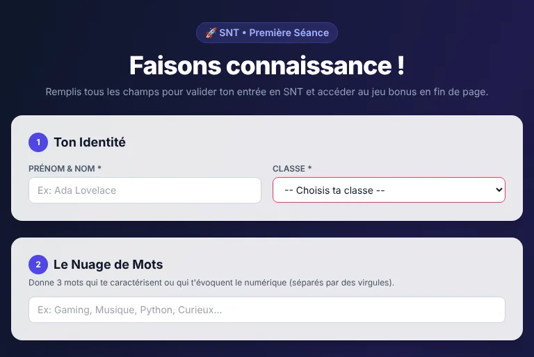

# 👋 SNT 1er jour : brise-glace et découverte

**Un formulaire pour faire connaissance à la première séance de SNT, et le nuage de mots de la classe qui se construit avec les réponses.** Pour la seconde, en SNT.

> Les élèves se présentent en cinq étapes : leur identité, trois mots qui les caractérisent ou que le numérique leur évoque, leurs goûts culturels, une citation à choisir et une question pour toi. Leurs mots rejoignent ceux de leurs camarades dans **le nuage de mots de la classe**, à projeter au tableau. Qui finit en avance débloque un jeu bonus pour s'entraîner à taper au clavier.

## 👉 [Essayer maintenant : babash.github.io/SNT-1er-Jour](https://babash.github.io/SNT-1er-Jour/)

**Gratuit · sans compte · rien à installer · aussi sur téléphone · prénom et nom, enregistrés en ligne**

SNT 1er jour fait partie des [Ressources NSI et SNT](https://babash.github.io/Babash-NSI-SNT/), rubrique [SNT](https://babash.github.io/Babash-NSI-SNT/snt/).

---

## Une séance en trois étapes

1. **Tu** projettes l'adresse de la page au tableau. Telle quelle, la page est réglée pour les classes 209 à 212 de Babash - NSI Tani Malandi : pour les tiennes, fais d'abord ta copie (voir « Pour aller plus loin »).
2. **Les élèves** remplissent les cinq étapes du formulaire, toutes obligatoires, puis cliquent sur **Valider et débloquer le jeu bonus !** Qui finit en avance joue à **Z-Type**, un jeu de tir spatial au clavier (site externe), qui s'ouvre dans un nouvel onglet.
3. **Tu fais le bilan** : le nuage de mots projeté, avec toutes les classes ou une seule (menu **Classe 209**…). Après la séance, tu lis les questions dans le tableau de bord de Supabase pour y répondre au cours suivant, puis tu effaces les réponses.

Tu veux d'abord découvrir la page seul·e ? Parcours-la sans valider : chaque envoi s'ajoute aux réponses enregistrées.

## Ce que font les élèves

| Étape | À l'écran | Ce que les élèves donnent |
|---|---|---|
| 1 | **Ton Identité** | leur prénom et leur nom, leur classe |
| 2 | **Le Nuage de Mots** | 3 mots qui les caractérisent ou que le numérique leur évoque, séparés par des virgules |
| 3 | **Tes Goûts Culturels** | leur musique préférée (un lien YouTube), leur livre ou manga, leur série ou film |
| 4 | **Ta citation préférée** | une citation sur quatre : Grace Hopper, Douglas Rushkoff, Arthur C. Clarke, ou un « proverbe geek » sur le binaire |
| 5 | **Ta question au prof** | une question sur la SNT, le numérique ou autre, avec la réponse au cours suivant |

En bas de la page, le **nuage de mots** de la classe : chaque mot en minuscules, d'autant plus grand qu'il a été donné souvent. Un menu affiche toutes les classes ou une seule. Le nuage se recharge à l'ouverture de la page et après l'envoi d'une réponse.

## Pour quels usages

| Usage | Comment |
|---|---|
| **Une séance en classe** (la première de l'année) | Le formulaire, puis le nuage projeté pour se présenter et lancer l'année ; Z-Type pour qui finit en avance. |
| **Sur téléphone** | La page passe sur une colonne, et le nuage s'adapte à la largeur de l'écran. |
| **Avec des collègues** | Chaque collègue fait sa copie, avec sa propre base et ses classes (voir « Pour aller plus loin »). |

## Pourquoi ça marche

- **Chaque élève a sa place dans le nuage** : ses mots rejoignent ceux de la classe, et le nuage projeté donne de quoi se présenter et discuter dès la première heure.
- **Une question par écrit** : chaque élève pose sa question sans prendre la parole devant la classe ; la réponse vient au cours suivant.
- **La culture informatique par petites touches** : une citation à choisir, de Grace Hopper à un proverbe sur le binaire, à commenter ensemble.
- **Le clavier dès le premier jour** : qui finit en avance s'entraîne à taper plus vite avec Z-Type, et personne n'attend sans rien faire.

## Données des élèves

- **Enregistré en ligne** (Supabase) : le prénom et le nom, la classe, les mots-clés, la citation choisie (son numéro), la question au prof, les goûts (un lien YouTube, un livre ou manga, une série ou un film) et la date d'envoi. Pas d'adresse électronique. Le nom de famille est demandé : c'est une exception décidée pour cette ressource.
- **Visible par les autres** : seulement le nuage des mots-clés, par classe, pour toute personne qui ouvre la page. La page ne reçoit que les mots et leur nombre, jamais les noms, les questions ni les goûts ; les élèves ne peuvent ni relire ni modifier les réponses, même la leur.
- **Sur l'appareil** : rien, ni cookie ni stockage du navigateur.
- **Pour effacer** : l'enseignant·e qui gère la base, dans le tableau de bord de Supabase (**Table Editor** ou **SQL Editor**), après usage.

Le détail : [supabase/LISEZMOI.md](supabase/LISEZMOI.md).

## Pour aller plus loin

### Faire ta copie

Telle quelle, la page envoie les réponses dans la base de Babash - NSI Tani Malandi et ne propose que ses classes. Pour tes classes :

1. Copie le dépôt (**Fork**) et publie-le avec GitHub Pages.
2. Crée un projet [Supabase](https://supabase.com) ; dans **SQL Editor**, lance `supabase/0-table.sql`, `supabase/1-nuage.sql`, puis `supabase/2-fermer-lecture.sql`.
3. Dans `index.html`, mets l'adresse et la clé publique de ton projet (la clé « anon » ou « publishable », jamais la clé « service_role » ou « secret »), puis tes classes, dans la liste du formulaire et dans le filtre du nuage.

Lire et effacer les réponses, revenir en arrière : [supabase/LISEZMOI.md](supabase/LISEZMOI.md).

## Contact

Conçu par Babash - NSI Tani Malandi pour les classes de SNT de l'académie de Mayotte. Ce README et la protection des réponses (dans la page et dans le dossier `supabase/`) sont faits avec l'aide de l'IA ([Claude Code](https://claude.com/claude-code)).
Une question, une idée, un bug ? Les [issues GitHub](https://github.com/babash/SNT-1er-Jour/issues) du dépôt. Toutes les ressources sont sur le site [Ressources NSI et SNT](https://babash.github.io/Babash-NSI-SNT/).

## Licence

- **Le code** (`index.html` et les scripts SQL de `supabase/`) est sous licence [MIT](LICENSE).
- **Les documents** (ce README, `supabase/LISEZMOI.md` et la capture de `docs/img/`) sont sous licence [CC BY-SA 4.0](https://creativecommons.org/licenses/by-sa/4.0/deed.fr).
- **Les bibliothèques** que la page charge depuis des CDN, sans copie dans le dépôt : [Tailwind CSS](https://tailwindcss.com) (MIT), [supabase-js](https://github.com/supabase/supabase-js) (MIT), [wordcloud2.js](https://github.com/timdream/wordcloud2.js) de Timothy Guan-tin Chien (MIT) et [Font Awesome Free](https://fontawesome.com) 6.4.0 (icônes CC BY 4.0, polices SIL OFL 1.1, code MIT).
- **Les citations** du formulaire restent à leurs auteurs et autrices ; **Z-Type** est un jeu externe, sur son site [ztype.com](https://ztype.com/).

Tu peux les réutiliser et les modifier, y compris pour tes classes, en mentionnant Babash - NSI Tani Malandi et la licence ; un document modifié se partage sous la même licence. Si tu utilises l'IA pour les modifier, merci de le préciser.
